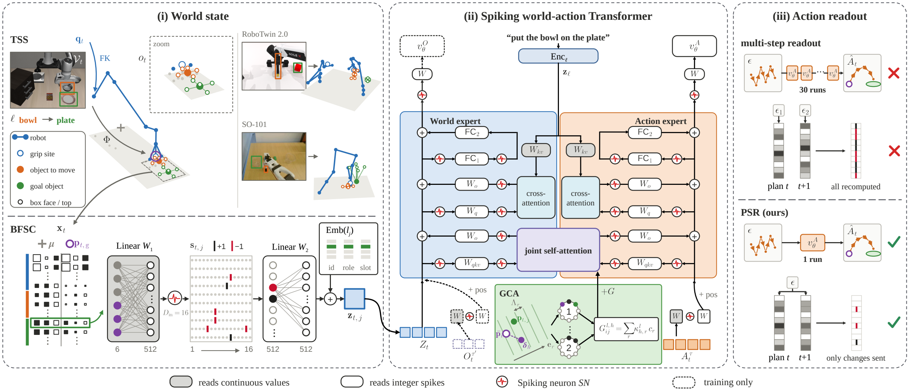
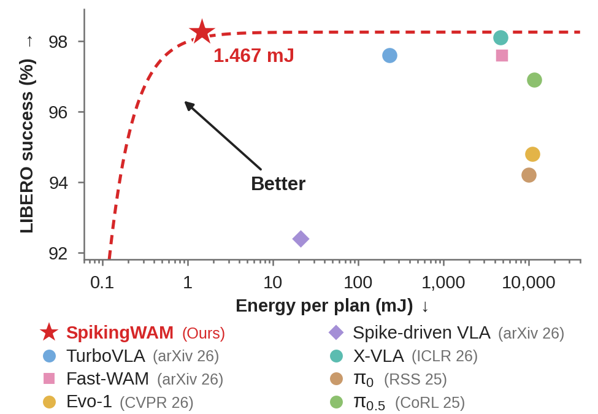
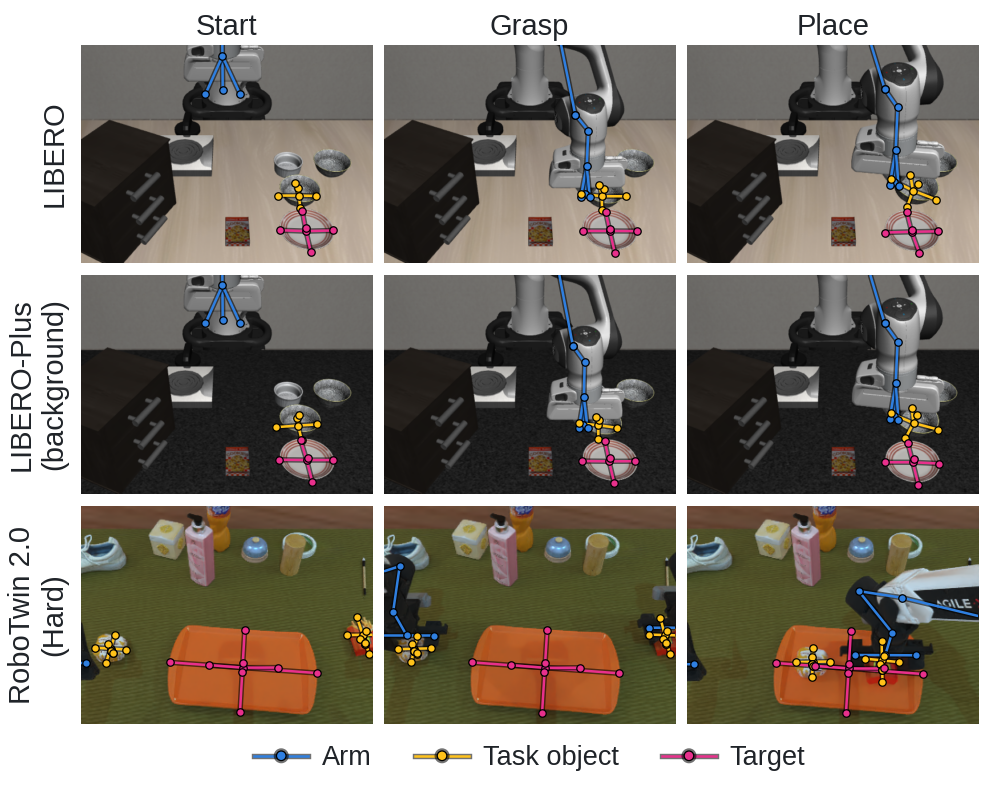
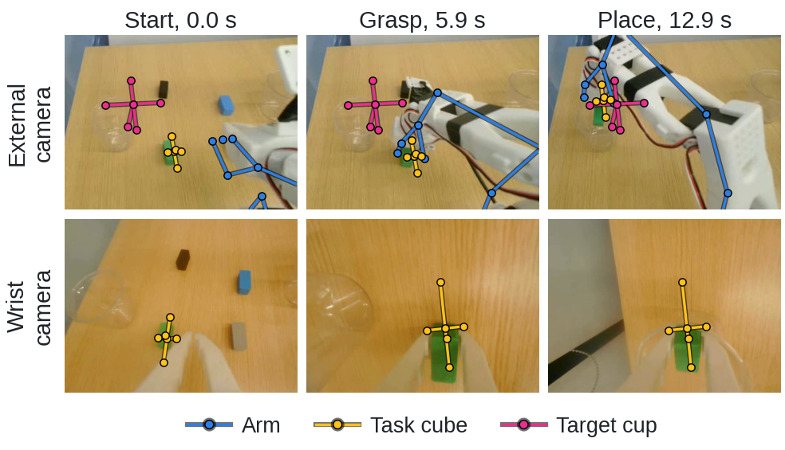

<div align="center">

<h1>SpikingWAM</h1>

<p><strong>A spiking world-action model for robot manipulation</strong></p>

<p>
<a href="#how-it-works">Method</a> ·
<a href="#benchmark-results">Results</a> ·
<a href="#robot-demonstration">Robot demonstration</a> ·
<a href="docs/reproduction.md">Reproduction guide</a>
</p>

</div>

<p align="center">
  
</p>

SpikingWAM represents a manipulation scene as a sparse 3D skeleton of the robot and the objects relevant to a language instruction. A spiking Transformer learns to predict future skeletons and generate continuous action chunks. The future-skeleton branch provides supervision during training, and the action branch produces the chunk used for closed-loop control.

## How it works

| Component | Role |
| --- | --- |
| **Task Skeleton State (TSS)** | Combines robot keypoints from forward kinematics with task-object keypoints estimated from camera images by a spiking perception front end. |
| **Body Frame Spike Coding (BFSC)** | Encodes each keypoint in both the robot base frame and the gripper frame. A fine-resolution coordinate adapter preserves the offsets needed for manipulation. |
| **Grid Coincidence Attention (GCA)** | Uses coincidences in shifted grid codes to add relative geometry to attention. |
| **Persistent Single-Step Readout (PSR)** | Produces a full action chunk in one network pass per plan on LIBERO and LIBERO-Plus. Reusing the initial noise across replans allows unchanged activations to be reused in event-driven execution. |

## Benchmark results

| Benchmark | Success rate | Evaluation |
| --- | ---: | --- |
| LIBERO | **98.25%** | 2,000 episodes across four suites |
| LIBERO-Plus | **88.76%** | 10,030 variants across seven perturbation categories |
| RoboTwin 2.0 | **80.20%** | 83.02% Easy and 77.38% Hard across 50 bimanual tasks |

SpikingWAM uses an estimated **1.467 mJ per LIBERO plan**, including 0.821 mJ for perception and 0.646 mJ for the policy. The estimate uses operation counts at 45 nm with 4.6 pJ per multiply–accumulate and 0.9 pJ per spike accumulation. RoboTwin 2.0 uses a medoid over three 10-step samples for action readout.

<p align="center">
  
</p>

<details>
<summary>LIBERO suite results and simulation rollouts</summary>

| Spatial | Object | Goal | Long | Average |
| ---: | ---: | ---: | ---: | ---: |
| 99.0% | 100.0% | 98.2% | 95.8% | **98.25%** |

<p align="center">
  
</p>

</details>

## Robot demonstration

On an **SO-101** arm, SpikingWAM placed the green cube in the left cup in **7 of 10 trials**. The estimated energy was **3.07 mJ per plan**. Mean inference latency was **4.4 ms**, with **0.63 GiB** peak GPU memory measured on an H100 in BF16.

<p align="center">
  
</p>

## Getting started

Install the benchmark environment and prepare the datasets and weights described in the [reproduction guide](docs/reproduction.md). The Python entry points run from the repository root.

```bash
python -m spikewam.train --help
python -m spikewam.eval_libero --help
python -m spikewam.eval_libero_plus --help
```

| Path | Contents |
| --- | --- |
| [`spikewam/`](spikewam/) | Spiking policy, ANN baseline, geometry, perception, language encoding and benchmark adapters |
| [`scripts/`](scripts/) | Skeleton extraction, front-end training, energy accounting and analysis |
| [`setup/`](setup/) | Environment setup and launch scripts for training and evaluation |

The repository contains source code and figures. Benchmark assets, demonstration datasets and model checkpoints are separate inputs.
